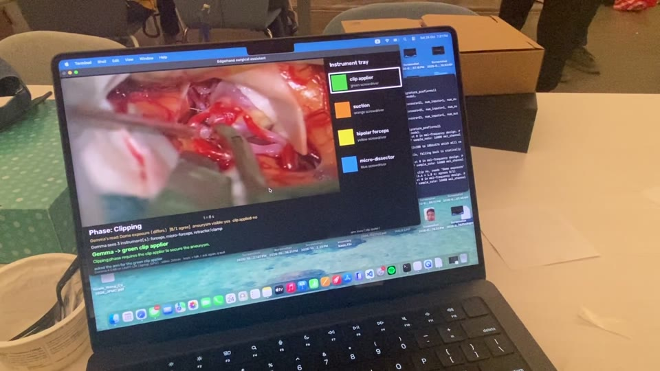

# EdgeHand: Phase-Aware Robotic Instrument Handoff with On-Device Multimodal Gemma 4

*The scrub nurse that never looks away: it watches, predicts, and hands it over, fully offline.*

Gemma Hardware Hackathon, AGI House, Oct 24 2026. Track 2 (Gemma in IoT / Robotics / Embedded) and Best Use of LiteRT. Model sizes, Jetson benchmarks and hardware are in [Technical specs](#technical-specs). Submission text for the project page is in [section 9](#9-submission-copy-project-page).

**Demo video (54 s):** [demo/edgehand_demo.mp4](demo/edgehand_demo.mp4)

[](demo/edgehand_demo.mp4)

> **The idea in one line:** a robot arm that watches the surgery, works out which instrument comes next, *asks* the surgeon, and hands it over handle-first. Gemma 4 runs on-device through LiteRT-LM, and nothing leaves the room.

---

## 1. System at a glance

```
 ┌──────────────────────────── JETSON ORIN NANO SUPER (192.168.55.1) ─────────────────────────────┐
 │  surgical_feed.py   public aneurysm-clipping clip plays as the "operating microscope" camera     │
 │                     ├─ MJPEG video  :8090  ─────────────────────────────────────────┐           │
 │                     └─ phase events (phase timeline)  UDP :5007 ───────────────────┐     │      │   │
 │  cam_relay.py       Intel RealSense D435 on the arm's wrist → colour MJPEG :8089 ──┼─────┼──────┐   │
 │  network bridge     arm Ethernet → Jetson RJ45 (192.168.1.12, NAT) → USB-C → Mac  │     │      │   │
 └──────────────────────────────────────────────────────┬───────────────────────────┼─────┼──────┼───┘
                                                        │ USB-C (one cable)           │     │      │
 ┌──────────────────────────── MACBOOK (M-series)  192.168.55.100 ───────────────────▼─────▼──────┼───┐
 │  assistant.py   ── Gemma 4 E4B on LiteRT-LM (GPU) ─────────────────────────────────────────────│   │
 │     1. SCENE   (image)  frame → instruments in view, aneurysm visible?, clip applied?, phase read │   │
 │     2. DECIDE  (text)   scene + phase + tray → instrument + reason                               │   │
 │     3. SPEAK   macOS `say` (offline): "Clipping. Shall I bring the green clip applier?"          │   │
 │     4. LISTEN  mic → Gemma audio → transcript → yes / no / "the suction" / stop / let go          │   │
 │        └─ on "yes" → request  UDP :5006 ──┐          ▲ arm_state (busy/holding/idle) UDP :5007   │   │
 │  run_kortex.py  (Kortex API, no ROS)  ◄────┘──────────┘                                           │   │
 │     look pose → wrist camera (via Jetson :8089) → AprilTags → table map → find + name tool  ◄─────┘   │
 │     → safety checks → pick by the handle → present → release on the surgeon's tug                    │
 └──────────────────────────────────────────────────────┬─────────────────────────────────────────────┘
                                                        │ Kortex API over Ethernet (routed through the Jetson)
                                               ┌────────▼────────┐
                                               │ KINOVA GEN3 7-DoF│  Robotiq 2F-85 gripper, RealSense on the wrist,
                                               │  192.168.1.10   │  red E-stop in a human hand
                                               └─────────────────┘
```

## 2. Where everything runs

| Machine | Runs | Talks to |
|---|---|---|
| **MacBook** (Apple M-series) | `assistant.py`: **all Gemma inference** (LiteRT-LM, GPU), the stage screen, mic + speech. `run_kortex.py`: the arm, wrist-camera vision, every safety check | Jetson over one USB-C cable; the arm through the Jetson |
| **Jetson Orin Nano Super** (JetPack 6.2) | `surgical_feed.py`: the surgical clip as a live camera feed + phase events. `cam_relay.py`: the RealSense colour stream. Network bridge to the arm | Mac (USB-C, 192.168.55.x); arm (Ethernet, 192.168.1.x) |
| **Kinova Gen3** + Robotiq 2F-85 | Motion through the Kortex API (Cartesian reaches, gripper, joint torques) | Mac, via the Jetson |
| **Intel RealSense D435** (on the wrist) | Colour camera for finding the instruments on the tray | Jetson (USB 3) |

**Ports.** UDP 5006 carries requests to the arm runner. UDP 5007 carries phase events and arm state to the assistant. HTTP 8089 is the wrist-camera stream and HTTP 8090 is the surgical-video stream. There's no internet and no cloud anywhere.

**Why Gemma runs on the Mac and not the Jetson.** We tested Gemma 4 on the Orin Nano through LiteRT. The GPU path ran out of memory (Vulkan OOM on the 8 GB board) and the CPU path took 31 s per text request. On the Mac's GPU it takes ~1.5 s for text and ~6.5 s with an image. So the Jetson does what it's best at, video and I/O, and the Mac does the reasoning. The phase model is a different story. At 24.6 M parameters it runs on the Jetson's GPU in ~4 ms per second of video (TensorRT FP16, measured; see the specs in section 7). Gemma 4 **E2B** (the 2 GB GPU build, `gemma-4-E2B-it-gpu.litertlm`) *does* run on the Jetson's GPU through LiteRT-LM (WebGPU accelerator): measured at 1.7 s per short text request after a ~10 s first-call warm-up, alongside the live video feed. It isn't in today's live loop.

## 3. End-to-end flow (one handover)

| # | Step | Where | Time |
|---|---|---|---|
| 1 | The clip reaches a new phase, e.g. *Clipping*. The Jetson sends `{"type": "phase", "phase": "Clipping"}` | Jetson | — |
| 2 | **Gemma, scene:** looks at the current microscope frame *without being told the phase*: "3 instruments: forceps, clip applier, micro-dissector; aneurysm visible: no; clip applied: yes; my read: Clipping" | Mac, Gemma (vision) | ~6.5 s |
| 3 | **Gemma, decide:** scene report + phase + tray → "green clip applier: clipping phase requires the clip applier to place or adjust clips" | Mac, Gemma (text) | ~1.7 s |
| 4 | **Ask:** the laptop says *"Clipping. Shall I bring the green clip applier?"* If the arm is busy, it waits and asks when the arm is free | Mac, `say` | ~2 s |
| 5 | **Listen 3.5 s:** Gemma transcribes; fixed keywords decide yes / no / stop / let go; Gemma maps a named alternative ("no, the suction") | Mac, Gemma (audio) | ~1–3 s |
| 6 | On **yes**: request → arm runner. The arm moves to the look pose; the wrist camera finds the four instruments (AprilTag table map, colour accent naming) | Mac + Jetson camera | a few s |
| 7 | **Pick:** rise, travel high, descend, slow last 3 cm, close on the handle, lift, carry. Every target is checked against the measured table plane | Arm | 20–40 s |
| 8 | **Present** at chest height, handle toward the surgeon. **Release on a tug** (wrist torque change) or "let go" | Arm | until taken |
| — | **Voice any time** (press `v`): "I need suction", "stop", "let go" | Mac | ~1–3 s |

## 4. Where Gemma comes in

All of it is **Gemma 4 E4B on LiteRT-LM, on the laptop**. One model handles vision, audio and text.

| Role | Input → output | Guardrail |
|---|---|---|
| **Surgical scene understanding** | microscope frame → instruments in view, aneurysm visible, clip applied, its own phase read | It isn't told the phase, so its read is independent; it's shown next to the timeline's phase |
| **Instrument decision** | scene + phase + tray → instrument + one-line reason | It picks from 4 colours only (whitelisted); it never outputs coordinates; a human must say yes |
| **Listening** | microphone audio → transcript (neutral prompt) | Stop, release, yes and no come from fixed keywords, never from Gemma's judgement |
| **Request mapping** | "no, give me something to coagulate" → yellow bipolar forceps | Whitelisted to the tray |
| **Typed requests and tool naming** (fallback) | text → tool class; tray image → tool names | Used when the assistant isn't running. During the demo the arm names tools by colour, so only one process uses the GPU |

**Gemma chooses *what*; deterministic code decides *how*.** Geometry comes from the AprilTags and the measured table plane. Motion goes through the Kortex API with clearance checks. Gemma can't move the arm on its own.

## 5. Safety, in layers

1. **The red E-stop** is in a human hand at all times.
2. **Human in the loop:** Gemma's suggestion moves nothing until the surgeon says "yes".
3. **Safety words without the model:** "stop", "wait", "let go" are matched by fixed keywords on the transcript. (In testing, a combined prompt made Gemma hear "stop" as "clip applier". So we split hearing from deciding.)
4. **The table is never touched:** the table plane is measured with fingertip touches on the four tags. Any grasp that would put the closed fingertips less than 4 mm above it is refused before anything moves.
5. **Motion style:** free moves rise first, turn only at height, travel at or above a floor 15 cm over the table, then descend; travel at 0.10 m/s, the last 3 cm onto the tool at 0.025 m/s.
6. **Release only on intent:** the gripper opens on a deliberate tug (joint-torque change, ~100× the sensor noise) or a spoken "let go".

## 5b. How the arm picks a tool up

No ROS, no MoveIt, no learned grasping: a calibrated camera, classical vision, and a small state machine over the Kinova Kortex API. Every number below is measured on the cell, not assumed.

**Calibrate once per site (6 minutes).** Four AprilTags are taped at the tray corners. For each, the closed fingertips are jogged down to pinch a sheet of paper on the tag's centre and the pose is read: that gives the tag's position in the arm's base frame **and** the table height under it. A plane through the four touches is the table (the venue's four agree within 1.9 mm). Because the same gripper measured it, ruler errors in the fingertip length cancel out. The look pose (camera straight down, ~0.5 m up, all four tags in view) is saved the same way. Everything lands in `data/calibration.json`; moving the cell means re-measuring, not editing code.

**Look.** Before every pick the arm goes to the look pose and the Jetson streams the RealSense colour frame. The tags in the frame give a pixel→table homography (2 tags are enough; the last good fit is reused if a hand hides them), so tool positions come out in metres in the arm's frame with ~3 mm error.

**Find and name.** The tray is warped to a top-down view. Anything that differs from the paper's colour is an object; blobs touching the edge of the view (the gripper's own fingers) are dropped. Along each blob's long axis its width profile says which end is the handle (wide) and where the metal starts (the width drops), so the grasp point is placed 2 cm into the handle from the ferrule, leaving the free end for the surgeon. The handle's **dominant colour accent** names it (green, red cap, yellow collar, blue collar), which works for black handles too. Gemma is not in this loop; it only ever names *which* tool, never where.

**Plan the pick.** The target is the flange pose that puts the pads on the handle at the measured table height plus the handle's radius. Before anything moves, every waypoint is checked: inside the workspace, and the closed fingertips at least **4 mm above the table plane** at the bottom of the descent; anything lower is refused outright. The fingers close across the tool, so the grasp is the same turned by 180°; the planner takes the yaw needing the smaller wrist turn and flips the handover orientation to match.

**Move, safely by construction.** Free moves always go *rise → turn at height → travel at or above a floor 15 cm above the table → descend over the target*, so nothing ever travels low over the tray. Travel runs at the arm's 0.10 m/s limit, the straight descent at 0.08 m/s, and the last 3 cm at 0.025 m/s. Each reach is confirmed from the measured pose, not just the controller's "done" message, and a reach that stops making progress is stopped. From Kinova's folded Retract pose a joint-space Home move runs first, because Cartesian moves are refused from a joint limit.

**Grasp and check.** The gripper pre-opens to the tool's measured width plus 12 mm each side (~38 mm, not the full 85, so it can't straddle a neighbour), closes on the handle, lifts, and reads its own finger position: closed past the "empty" threshold means a miss, and the arm goes back to the look pose, looks again and retries, up to three times.

**Present and release.** The tool is carried to a fixed point at the surgeon's chest height with the handle toward them. The arm records the wrist joint torques as a baseline and opens when a deliberate tug changes them (~1.5 N·m, roughly 100× the sensor noise), or on a spoken "let go". It never opens the gripper in the air.

**Recover.** A restart with a tool still in the hand is a reset, not a resume: the arm rises, vision picks a free spot on the tray, and the tool is put down there with the same descent rules. A request arriving mid-handover isn't queued up: only the latest one is kept, and it runs once the surgeon has taken the current tool.

**What it took on the day.** The table plane from fingertip touches, the view-edge rule, the "rise before you turn" order, the measured-pose completion check and the pre-open width each came from a specific failure on the real arm; the MuJoCo sim and 89 unit tests re-run them all before every change.

## 6. What's live, and what isn't

| | Status |
|---|---|
| Gemma's scene analysis, instrument choice, speech, listening | **Live**, on-device |
| Wrist-camera vision, AprilTag calibration, the arm, the tug release | **Live**, real hardware |
| **The phase timeline** | Prepared for a public, licensed clip. Our phase-recognition model is real (see below), but its weights live with protected clinical data, so we can't show it running |
| The surgical video | A public clip played by the Jetson in place of a real microscope feed |
| The instruments | Colour-coded screwdrivers standing in for surgical tools |

## 7. Results

| What | Result |
|---|---|
| **Neurosurgical phase model** (offline, `NeurosurgicalPhaseRecognition/`): 48 expert-annotated aneurysm-clipping videos, 40,725 frames, held-out-video split | **95.7%** frame accuracy (ResNet50 + MS-TCN + Viterbi) |
| Gemma's **zero-shot** phase read on the demo clip | 3/7 agree with the timeline, which is why a specialised model supplies the phase |
| Gemma request understanding (59 phrases, 6 tool classes) | 93% |
| Gemma naming tools in a tray image (synthetic, including tools not on the list) | 88% |
| Multi-tool sim end to end (MuJoCo, wrist camera + Gemma naming) | 29/30 |
| Voice: 6 test phrases; confirmation (yes / no / redirect / stop / unclear) | 6/6; 5/5 |
| Latency: scene + decision / voice command | ~8 s / 1–3 s |
| **Real arm:** full handovers end to end, including release on tug | **[fill in: N of M on the day]** |

### Technical specs

**Neurosurgical phase model.** Architecture from `NeurosurgicalPhaseRecognition/`, with the training defaults. It was sized and benchmarked with random weights, because the trained weights stay with the clinical data.

| | Spec |
|---|---|
| Input | 1 frame per second, 224×224 RGB |
| Frame encoder | ResNet50 (ImageNet-initialised, fine-tuned on surgery): 23.5 M params, 2048-d feature, 4.1 GMACs per frame |
| Temporal model | MS-TCN with 2 stages × 8 dilated residual layers and 128 filters: 1.06 M params. Receptive field 1,021 frames (~17 min at 1 fps). 0.63 GMACs for a 10-min window |
| Output | 4 phases (brain exposure, parent vessel exposure, dome exposure, clipping), Viterbi-smoothed |
| Size | 24.6 M params in total: 98 MB fp32, 49 MB fp16. TensorRT FP16 engines are 48.0 MB + 2.7 MB |
| Accuracy | 95.7% frame accuracy on held-out videos (48 surgeries, 40,725 frames) |

**How the phase model was built** (`NeurosurgicalPhaseRecognition/`, offline, on the clinical data).

*Data.* 48 aneurysm-clipping surgeries, annotated frame by frame by experts into four phases: **Brain Exposure → Parent Vessel Identification → Dome and Neck Identification → Clipping** (the separate "neck" and "dome" annotations are merged into one phase; out-of-scope labels such as fluorescence segments are masked out of the loss with `ignore_index`). Labels are stored as one integer per frame at 1 frame/s, 40,725 labelled frames in all.

*Stage 1: frame encoder.* A **ResNet50 initialised from ImageNet** (torchvision's `IMAGENET1K_V2` weights) with its classification head replaced by a 2048→4 linear layer. It is **fine-tuned end to end on surgical frames** rather than used frozen: AdamW with two learning rates (a small one for the pretrained trunk, a larger one for the new head), batch 32, 224×224 inputs with ImageNet normalisation, and light augmentation (horizontal flip, brightness/contrast jitter), 10 epochs, best checkpoint by validation loss. The point of this stage is not the frame classifier itself but the feature space: after fine-tuning, the 2048-d global-average-pooled feature separates surgical content (instruments, tissue, clips) far better than the raw ImageNet feature.

*Stage 2: features.* Every video is sampled at **1 frame per second** and each frame is pushed through the fine-tuned encoder once; the 2048-d feature per second is cached to disk. The temporal model never touches pixels again, which is what makes training it fast and running it on the Jetson cheap.

*Stage 3: temporal model.* A **multi-stage temporal convolutional network (MS-TCN)** over the feature sequence of a whole video: 2 stages × 8 dilated residual layers (kernel 3, dilation 2ⁱ, 128 filters, dropout 0.5). Stage 1 maps features to per-frame phase logits; stage 2 takes stage 1's softmax and refines it, which is what removes short spurious flips. The receptive field is 1,021 s (~17 min), so a frame's phase is read in the context of the quarter hour around it.
Training: the loss is the **sum over both stages of class-weighted cross-entropy** (weights from the inverse phase frequencies, since Clipping is short and Brain Exposure long) with **label smoothing 0.1**; Gaussian noise (σ = 0.1) on the input features as regularisation; gradient clipping at 1.0; AdamW (lr 5·10⁻⁴, weight decay 10⁻³); a 5-epoch linear warm-up then cosine decay to 10⁻⁶ over 100 epochs; batches of 4 whole videos of different lengths, padded and masked. A feature-level augmentation (random temporal crops to 70–100 % of a video, plus noise) is available for the smaller training runs.

*Split and metrics.* The split is **by video** (80/20, fixed seed): no frames from a test surgery are seen in training, so the 95.7 % is on unseen operations, not unseen frames. Besides frame accuracy and macro-F1 we track the metrics that matter for a phase stream: normalised **edit distance** of the predicted segment sequence, **segmental F1 at 10/25/50 % overlap**, and accuracy with frames within ±5 s of a true transition masked out, because disagreements at boundaries are often annotation ambiguity.

*Stage 4: Viterbi decoding.* Phases in this operation only go forward. The per-frame probabilities are decoded with Viterbi under a **transition matrix**: by default stay = 0.95, advance one phase = 0.04, skip a phase = 0.009, go back = 0.001, anything else effectively forbidden; optionally the matrix is estimated from the training labels' actual transition counts. This turns a frame classifier into a monotone, segment-level phase timeline and removes isolated flips that a plain 15-frame moving average would leave. The same prior is what the demo's phase feed reproduces: a monotone sequence of segments with timestamps.

*Why this stack.* Per-frame CNNs alone confuse visually similar moments (dissection before vs after clipping); the MS-TCN supplies the long context; Viterbi supplies the surgical grammar. The code also contains the baselines we tried on the way: CNN+LSTM and two transformer variants (`training/`), which the MS-TCN beat on edit distance at a fraction of the parameters.

**It fits on the Jetson Orin Nano Super.** We measured it on our board with TensorRT 10.3 FP16 (`trtexec`, JetPack 6.2):

| Stage | Mean latency | Throughput | GPU memory |
|---|---|---|---|
| ResNet50 encoder, one frame | 2.34 ms | 436 frames/s | 96 MiB |
| MS-TCN over a 10-min window (600 frames) | 1.75 ms | 694 windows/s | 159 MiB |

How it fits, in one table:

| | Phase model | Jetson Orin Nano Super |
|---|---|---|
| On disk | 98 MB fp32; **51 MB** as the TensorRT FP16 engines we run | — |
| Memory while running | **~255 MiB** of GPU memory | 7.6 GB usable, ~6.6 GB free with the video feed running, so **under 4%** |
| Compute at 1 frame/s | **~4 ms** of GPU time per second of video | under 0.5% of the GPU |

- The 98 MB figure is full precision. On the Jetson the model runs in fp16, which halves it.
- Size, memory and speed depend only on the architecture, so random weights give the same numbers the trained weights would.
- By contrast, Gemma 4 E4B (3.66 GB, the multimodal model we use) doesn't fit on the Jetson's GPU; the smaller E2B does (see below). That's why Gemma runs on the laptop and the Jetson is the right home for the phase model.
- At 1 frame per second, the phase model leaves the Jetson free for the video feed and the camera relay.
- Building the engines is a one-off and peaks at 1.7 GB of CPU RAM.
- For comparison, PyTorch on the Mac's CPU takes 53 ms per frame.
- As trained, the MS-TCN is offline: it looks at frames on both sides. A live version re-runs it each second over the frames so far, which costs under 2 ms, or switches to causal convolutions.

**Gemma 4 E4B on LiteRT-LM: one file, three modalities**

The whole AI side is one file, `gemma-4-E4B-it.litertlm` (3.66 GB, Gemma 4 E4B instruction-tuned), with its vision encoder, audio encoder and language model inside. `assistant.py` loads it once as a single LiteRT-LM `Engine` with vision and audio enabled, and that one engine handles everything below. There's no separate speech-recognition model, no separate vision model and no cloud API.

| Modality | What goes in | What comes out | Where it runs in LiteRT-LM | Time |
|---|---|---|---|---|
| **Vision** | One microscope frame, scaled to 512 px on the long side | JSON: how many instruments, which ones, aneurysm visible yes/no, clip applied yes/no, Gemma's own phase read | Vision encoder on CPU (XNNPACK), language model on GPU | ~6.5 s |
| **Text reasoning** | Phase + previous phase + the vision JSON + the 4-instrument tray | JSON: one instrument colour (must be on the tray) + a reason of at most 12 words | GPU | ~1.5 s |
| **Audio** | 3.5 s of microphone audio after the question, 16 kHz mono WAV (ffmpeg) | A word-for-word transcript. Fixed keyword rules turn it into yes / no / stop / let go; Gemma maps a named instrument ("no, the suction") onto the tray | Audio encoder on CPU, language model on GPU | 1–3 s |

- **Separate calls:** each call is a fresh conversation, so nothing carries over between calls. Vision isn't told the phase, so its phase read is an independent check.
- **Outputs:** every output is JSON checked against a whitelist. Bad JSON is retried, and a failed call means "didn't understand", never an action.
- **Audio:** it's transcribed with a neutral prompt that mentions no instruments and no phase. With the phase and tray in the same prompt, Gemma heard "stop" as "clip applier"; separating the steps fixed that.
- **Caches built on the first run (~350 MB):**
  - vision encoder, 218 MB;
  - audio encoder, 91 MB;
  - audio and vision adapters, 16 + 8 MB;
  - compiled GPU programs, 17 MB.

  Later starts reuse them.
- **Hardware:** a MacBook with an Apple M5 and 24 GB of unified memory. LiteRT-LM allows one GPU process at a time, so the assistant owns the GPU and the arm process names tools by colour.
- **On the Jetson:**
  - **E4B:** the GPU ran out of memory and the CPU took 31 s per text request, so the full multimodal model runs on the laptop.
  - **Gemma 4 E2B** (`gemma-4-E2B-it-gpu.litertlm`, 2.0 GB): runs on the Jetson's GPU through LiteRT-LM's WebGPU accelerator. Measured at 1.7 s per short text request after a ~10 s first-call warm-up, with the video feed still running. In a test it picked the clip applier for Clipping and mapped "no, give me the suction" to a request.
  - The same `.litertlm` format and the same Python API work on both devices. E2B on the Jetson isn't wired into today's live loop yet.
- **Speech out** uses macOS's built-in on-device voice (`say`). Gemma does the listening; the Mac does the talking.

**Hardware**

| | Spec |
|---|---|
| NVIDIA Jetson Orin Nano Super dev kit | 8 GB LPDDR5 (7.6 GB usable), 1024-core Ampere GPU with 32 Tensor Cores, 6-core Arm Cortex-A78AE, up to 67 TOPS INT8. L4T R36.4.7, TensorRT 10.3 |
| Kinova Gen3 | 7 DoF, 902 mm reach, torque sensing in every joint. Kortex API over Ethernet |
| Robotiq 2F-85 | Parallel gripper with an 85 mm stroke |
| Intel RealSense D435 | On the wrist. We use the colour stream; the stereo depth stream is unused today |
| Links | One USB-C cable from the Mac to the Jetson (192.168.55.x). Ethernet from the arm to the Jetson (192.168.1.x), with NAT. UDP/JSON events on :5006 and :5007, MJPEG on :8089 and :8090 |


**Software**

| Layer | Software | Runs on |
|---|---|---|
| Gemma runtime | **LiteRT-LM** Python API (`litert-lm-api` 0.18.1): GPU language model, CPU (XNNPACK) vision and audio encoders | Mac |
| Surgical assistant | `assistant.py`: the vision → decision → speak → listen loop, and the 1280×720 stage screen (OpenCV) | Mac |
| Arm runner | `run_kortex.py` on the **Kinova Kortex API** 2.8 (Python, protobuf 3.20): Cartesian and joint moves, the gripper, joint torques for the tug | Mac → arm |
| Vision | **OpenCV 5.0** `cv2.aruco` (AprilTag tag36h11, 50 mm tags), a table homography, contrast segmentation of the tray, colour-accent naming; numpy 2.4 | Mac |
| Calibration | `data/calibration.json`, loaded at start: the table tags and the fingertip-touched table plane. A new site means re-measuring, not editing code | Mac |
| Audio | **ffmpeg 8.1** (AVFoundation mic capture, 16 kHz mono) and macOS `say` | Mac |
| Video | `surgical_feed.py`: the clip as an MJPEG camera stream (:8090) plus phase events. `cam_relay.py`: the RealSense colour stream (:8089) | Jetson |
| Event bus | `link.py`: JSON over UDP (:5006 requests, :5007 phase and arm state), heartbeats, replies matched by request ID | Mac ↔ Jetson |
| Phase model | **PyTorch + torchvision** (training), exported to **ONNX** (opset 17), run with **NVIDIA TensorRT 10.3** FP16 | Training offline; inference on the Jetson |
| Simulation | **MuJoCo** with the MuJoCo Menagerie Gen3 and 2F-85 models: the full handover with the wrist camera, 20/20 | Mac |
| Tests | **pytest**: unit and integration tests, re-run before every change | Mac |
| Operating systems | macOS 26.6 (Apple M5). JetPack 6.2 / L4T R36.4.7 (Ubuntu 22.04) on the Jetson | — |
| Clinical integration (designed) | ROS 2 Humble + MoveIt 2 nodes, tested against a fake MoveIt | — |

---

## 8. The pitch (90 seconds)

**Hook, 8 s.**
"In aneurysm surgery, the surgeon works through a microscope on vessels a few millimetres wide, and every look away costs focus. A great scrub nurse has the next instrument ready before it's asked for. There aren't enough of them, and surgical video can't leave the room."

**Demo, 22 s (running).**
"The Jetson plays our operating-microscope feed. The surgery has just moved into clipping. Gemma 4 looks at the frame, sees the instruments in use and that the aneurysm is exposed, and asks."
*(Laptop: "Clipping. Shall I bring the green clip applier?" You: "Yes.")*
"The Kinova finds it on the tray with its wrist camera, picks it by the handle and holds it out. I pull, and it lets go."

**The Gemma technology, 20 s.**
"Everything you just saw is one Gemma 4 model: one 3.66 GB file, running through LiteRT-LM on this laptop. It *saw* the microscope image. It *reasoned* over the phase, the scene and the tray. It *heard* my yes straight from the audio, with no separate speech model. Three modalities, one file, one engine loaded once, about eight seconds from phase change to question. Pull the cable and nothing changes." *(pull it)*

**The system, 15 s.**
"Three devices, no cloud. The Jetson Orin Nano runs the video feed and is home to our phase model: 24.6 million parameters, 2.3 milliseconds a frame in TensorRT. The M5 laptop runs the full multimodal Gemma 4, and the smaller Gemma 4 E2B runs on the Jetson's GPU too, through the same LiteRT-LM runtime. The Kinova Gen3 does the motion, guided by a wrist RealSense and AprilTag calibration."

**Trust, 12 s.**
"Gemma decides *what*, never *how*. It picks from the tray, never outputs a coordinate, and nothing moves without a spoken yes. 'Stop' and 'let go' are fixed keywords. The arm stays 4 mm off the table, and I'm holding the E-stop."

**Credibility, 8 s.**
"The phase signal is our own model: 95.7% on 48 aneurysm surgeries. Gemma alone gets the phase 3 times in 7, so each model does what it's best at."

**Close, 5 s.**
"EdgeHand. It watches, predicts, and hands it over, fully offline."

### Slides (9)
1. **Title.** "EdgeHand: Phase-Aware Robotic Instrument Handoff with On-Device Multimodal Gemma 4". Tagline: "The scrub nurse that never looks away: it watches, predicts, and hands it over, fully offline."
2. **Why neurosurgery.** Millimetre vessels and seconds that matter. Too few experienced scrub nurses. OR video can't leave the room, so the intelligence has to be in the room.
3. **Systems.** Three boxes, top to bottom, with the links between them:
   - **NVIDIA Jetson Orin Nano Super** (8 GB, 67 TOPS, JetPack 6.2):
     - surgical video feed, MJPEG :8090;
     - phase events, UDP :5007;
     - RealSense relay, :8089;
     - network bridge to the arm;
     - phase model, TensorRT FP16 at 2.3 ms per frame.
   - ⇅ *one USB-C cable (192.168.55.x)*
   - **MacBook, Apple M5, 24 GB: Gemma 4 E4B on LiteRT-LM.** The loop is see → decide → ask (`say`) → listen → request (UDP :5006).
   - ⇅ *Ethernet through the Jetson, Kortex API*
   - **Kinova Gen3, 7 DoF + Robotiq 2F-85 + wrist RealSense D435.** The loop is look → AprilTag table map → find tool → pick → present → release on tug.
   - Footer: "No internet. No cloud. Every model on-device."
4. **Gemma 4 × LiteRT-LM.** The headline technology slide.
   - Left: **one file**. `gemma-4-E4B-it.litertlm` (3.66 GB) holds the vision encoder, audio encoder and language model. It's loaded once as one LiteRT-LM `Engine`: the language model on the GPU, vision and audio encoders on the CPU (XNNPACK), ~350 MB of compiled caches.
   - Middle: **three modalities, one engine**, with times:
     - *sees*: microscope frame → instruments, aneurysm, clip, phase read, ~6.5 s;
     - *reasons*: phase + scene + tray → instrument and reason, ~1.5 s;
     - *hears*: the surgeon's voice → words → yes / no / stop / which instrument, 1–3 s.
   - Right: **runs on two edge devices**:
     - MacBook M5: Gemma 4 E4B on the GPU (the live loop).
     - NVIDIA Jetson Orin Nano: Gemma 4 E2B on the GPU (WebGPU), 1.7 s per request.

     Same `.litertlm` format and the same API on both.
   - Footer: "No cloud API, no separate speech model, no separate vision model."
5. **Voice: talk to the robot.**
   - **EdgeHand speaks first.** The laptop says "Clipping. Shall I bring the green clip applier?" (on-device speech).
   - **The surgeon answers.** "Yes" fetches; "no" cancels; "no, the suction" redirects; "stop" and "let go" work any time. Push-to-talk (`v`) works too: "hand me the bipolar".
   - **How it hears**, in three steps:
     1. Gemma transcribes the 16 kHz audio with a neutral prompt.
     2. Fixed keyword rules handle yes / no / stop / let go.
     3. Gemma maps a named or described instrument onto the tray.
   - **Why three steps:** with the tray in the prompt, Gemma heard "stop" as "clip applier".
   - **Results:** 6/6 test phrases, 5/5 confirmation cases (yes / no / redirect / stop / unclear), 93% on 59 request phrasings, 1–3 s per command.
6. **The loop, timed.** The phase changes → vision ~6.5 s → decision ~1.5 s → spoken question → "yes" heard in 1–3 s → pick and hand over → release on tug.
7. **Safe by design.** Gemma decides *what*; code decides *how*:
   - whitelisted JSON;
   - no coordinates;
   - spoken yes required;
   - keyword stop and let go;
   - 4 mm table guard;
   - torque tug release;
   - E-stop.
8. **Technical specs.** Hardware table, software table, and the phase model on the Jetson: 24.6 M params, 51 MB of engines, 2.34 ms per frame, ~255 MiB (under 4% of the board).
9. **Results and close.**
   - Phase model: 95.7%.
   - Request understanding: 93%.
   - Tray naming: 88%.
   - Voice confirmation: 5/5.
   - Sim handover: 20/20.
   - Real arm: [N of M].

   Then the tagline.

### Judges' Q&A
- **Is the phase recognition live?** The phase model is real (95.7% on 48 surgeries, code in the repo), but its weights are tied to protected clinical data, so the demo replays a prepared timeline on a public clip. Everything Gemma does on top of it is live.
- **Why not have Gemma predict the phase?** We measured it: 3/7 zero-shot. A small specialised temporal model is far better at phases. Gemma is better at reasoning over the scene and talking to the surgeon.
- **Why one model for vision, voice and reasoning?** One 3.66 GB file and one engine means one model to load, update and validate, and no glue between separate models. The same `.litertlm` runs wherever LiteRT-LM runs, so the brain can move to new hardware unchanged.
- **What if Gemma is wrong?** It only suggests. The surgeon says no or names another instrument. Its outputs are restricted to the tray, and it never controls motion directly.
- **Is this a VLA?** No. That's deliberate: models choose what, deterministic code decides how. We think that's the right split near people.
- **Does Gemma run on the Jetson?** The smaller Gemma 4 E2B does: 1.7 s per request on the Jetson's GPU through LiteRT-LM. The full multimodal E4B (vision + audio) ran out of GPU memory on the 8 GB board, so the live loop runs E4B on the laptop and the Jetson handles video. Next, E2B on the Jetson can take the text and voice jobs.
- **How fast is it?** About 8 s from a phase change to the question, 1–3 s for a voice command, and 20–40 s for a handover at a deliberately slow 20% speed.
- **What about patient data?** None is used or shown. The clip is public and licensed, and the clinical labels and weights never left their source.
- **Does the phase model fit on the Jetson?** Yes. It has 24.6 M parameters (49 MB in fp16). With TensorRT FP16 on our Orin Nano Super, it takes 2.3 ms per frame for ResNet50 plus 1.75 ms per 10-minute window for the MS-TCN, using ~255 MiB of GPU memory. The model that doesn't fit is the full Gemma 4 E4B; the smaller E2B does.
- **What would you build next?** Run the phase model live on the Jetson (TensorRT engines already built and benchmarked), feed Gemma's scene features into it alongside the CNN features, and use real surgical instruments with a 3D grasp from the RealSense depth stream.

---

## 9. Submission copy (project page)

### Title and tagline
> **EdgeHand: Phase-Aware Robotic Instrument Handoff with On-Device Multimodal Gemma 4**
> *The scrub nurse that never looks away: it watches, asks, and hands it over, fully offline.*

Other titles:
- EdgeHand: An Air-Gapped Multimodal Scrub-Nurse Robot for Neurosurgery (stresses offline and neurosurgery)
- EdgeHand: Phase-Conditioned, Human-Confirmed Instrument Delivery on the Edge (stresses the ask-first safety design)
- EdgeHand: Anticipatory Surgical Instrument Handoff with Gemma 4 on LiteRT (stresses the LiteRT prize)

Other taglines:
- *Watches. Asks. Hands it over. Nothing leaves the room.*
- *It anticipates the next instrument, and asks before it moves.*
- *Gemma sees the surgery, the surgeon says yes, and the arm delivers, fully on-device.*

### Describe your project

**EdgeHand: the scrub nurse that never looks away.** An offline robotic scrub nurse for neurosurgery, powered by Gemma 4 running entirely on the edge.

**Why neurosurgery needs this.** In an aneurysm clipping, the surgeon works through a microscope on blood vessels a few millimetres wide, right beside a bulge in the artery wall that can rupture. The critical moments come down to seconds and steady hands. Every time the surgeon looks away from the eyepiece, or waits for the right instrument, focus breaks at exactly the wrong time. A great scrub nurse prevents that by having the next instrument ready before it's asked for. That skill takes years to build, and experienced scrub nurses are scarce. The operating room is also the one place you can't send video to the cloud: patient privacy, unreliable connectivity, and zero tolerance for an outage mid-procedure. So the intelligence has to live in the room.

**What EdgeHand does.** It watches the surgery, recognises the phase, sees what's already in the field, anticipates the next instrument, and **asks**: *"Clipping. Shall I bring the clip applier?"* On a spoken "yes", a Kinova Gen3 arm finds the instrument on the tray with its wrist camera, picks it by the handle, and presents it handle-first. When the surgeon pulls, it lets go. The surgeon can speak to it at any time: "no, the suction", "stop", "let go".

**Where Gemma comes in.** One Gemma 4 model handles vision, audio and reasoning, on-device through LiteRT-LM:
- **It sees:** it reads the microscope frame, counts the instruments in use, and judges whether the aneurysm is exposed and whether a clip is already on.
- **It reasons:** it combines the surgical phase, the scene and the tray into a choice and a one-line reason.
- **It listens:** it understands the surgeon's voice directly from audio.

Pull the network cable and nothing changes.

**Built to be trusted near a patient.** Gemma decides *what*, never *how*:
- It chooses only from the instruments on the tray and never outputs a coordinate.
- Nothing moves without a spoken "yes".
- "Stop" and "let go" are hard-wired keywords that never depend on the model.
- The arm calibrates the table with fingertip touches and refuses any grasp that would bring it within 4 mm of the surface.
- A human holds the red E-stop throughout.

**Grounded in real neurosurgical AI.** The phase signal comes from our own surgical phase-recognition model: **95.7% accuracy on 48 expert-annotated aneurysm-clipping surgeries** (ResNet50 + MS-TCN). Its weights are tied to protected clinical data, so the demo replays a prepared phase timeline on a public surgical video. Everything Gemma does on top of it is live. The phase model has 24.6 M parameters, and with TensorRT on the Jetson's GPU it needs about 4 ms per second of video, so it is ready to run live next to the camera. We also measured Gemma reading phases on its own: 3 of 7 correct. That's exactly why EdgeHand pairs a specialised phase model with Gemma's reasoning and conversation.

**Next:** real surgical instruments with 3D grasping from the depth camera, the phase model running live on the Jetson, and testing with surgical teams.

### Tech stack

- **AI:** Gemma 4 E4B (vision, audio and text in one model), on-device via **Google LiteRT-LM** (GPU, fully offline)
- **Surgical phase recognition:** PyTorch, ResNet50 features + MS-TCN temporal model + Viterbi decoding (95.7% on 48 aneurysm-clipping videos; 24.6 M params), exported to ONNX and **NVIDIA TensorRT FP16** on the Jetson (2.3 ms per frame)
- **Robot:** Kinova Gen3 7-DoF arm + Robotiq 2F-85 gripper, controlled through the **Kinova Kortex API** (Python)
- **Vision:** Intel RealSense D435 on the wrist, OpenCV, AprilTag table calibration, contrast segmentation, and colour-accent instrument identification
- **Edge compute:**
  - **NVIDIA Jetson Orin Nano Super:** surgical video node, camera relay, network bridge to the arm
  - **MacBook (Apple silicon):** Gemma inference, motion and safety
- **Voice:** Gemma native audio understanding, macOS on-device speech synthesis, keyword-gated safety commands
- **Networking:** air-gapped USB-C and Ethernet links, a lightweight UDP/JSON event bus, MJPEG video streams
- **Safety and testing:** joint-torque tug detection, fingertip-calibrated table plane, MuJoCo physics simulation of the full handover, and pytest unit and integration tests
- **Languages:** Python, with ROS 2 / MoveIt 2 designs for future clinical integration
